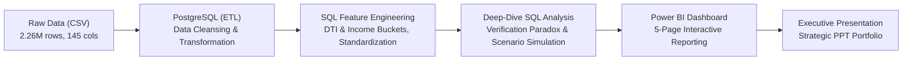

# 💳 Lending Club Loan Performance & Credit Risk Analytics
### *Optimizing Credit Risk Assessment & Loan Portfolio Strategy (2007–2018)*

**Author:** [Andre Saputra Ginting](https://www.linkedin.com/in/andre-saputra-ginting/)  
**Role:** Data Analyst  
**Tools:** PostgreSQL, Power BI, Python  
**Dataset:** [Lending Club Loan Data (Kaggle)](https://www.kaggle.com/datasets/wordsforthewise/lending-club) — *2.26 Million Loans, 145 Raw Attributes*

---

## 📌 Executive Summary & Project Background

Lending Club merupakan platform *peer-to-peer (P2P) lending* terbesar di Amerika Serikat yang menghubungkan debitur (*borrowers*) dengan investor. Pada periode 2007–2018, platform telah memfasilitasi penyaluran dana sebesar **$33.97 Miliar** kepada **2.26 juta peminjam**. 

Kendati volume penyaluran bertumbuh secara eksponensial (mencapai puncaknya ~490 ribu pinjaman baru di tahun 2018), platform menghadapi risiko kredit yang masif:
- **Tingkat Gagal Bayar Tinggi:** Dari seluruh pinjaman yang telah tuntas siklus hidupnya (*completed loans*), **20.09% berakhir gagal bayar (*Charged Off*)**.
- **Kerugian Modal Investor:** Total kerugian bersih pokok pinjaman (*net loss*) dari pinjaman macet mencapai **$1.92 Miliar** (sekitar 262 ribu debitur).
- **Distribusi Profitabilitas Timpang:** Laba bersih platform (*Realized Net Profit*) tercatat sebesar **+$500.43 Juta (ROI 2.66%)**, namun disumbangkan hampir seutuhnya oleh Grade A, B, dan C, sedangkan pinjaman Grade bawah justru merugi dan menggerus keuntungan.

**Tujuan Proyek:**  
Menganalisis akar penyebab kegagalan bayar (*root cause analysis*), memvalidasi anomali risiko, menyusun segmentasi prediktif, serta merumuskan simulasi kebijakan kredit berbasis data (*prescriptive scenario simulation*) untuk menekan rasio gagal bayar sekaligus mengamankan profitabilitas modal investor.

---

## 🏗️ End-to-End Analytics Workflow



---

## 📂 Repository Structure

```text
├── sql/
│   ├── 01_create_table_raw.sql                     # DDL skema tabel mentah (145 kolom)
│   ├── 02_transform_and_create_clean_loan.sql      # Transformasi data & feature engineering (45 kolom)
│   ├── 03_clean_outliers_and_anomalies.sql         # Pembersihan NULL, DTI negatif, & sentinel 999
│   ├── 04_standardize_home_ownership.sql           # Konsolidasi kategori kepemilikan rumah (ANY/NONE -> OTHER)
│   ├── 05_feature_eng_income_bucket.sql            # Binning strata pendapatan (US Census Bureau)
│   ├── 06_feature_eng_dti_bucket.sql               # Binning rasio hutang DTI (Standar CFPB/Fannie Mae)
│   ├── 07_analysis_verification_paradox_validation.sql # Validasi bias seleksi pada status verifikasi
│   └── 08_prescriptive_policy_simulation.sql       # Simulasi dampak kebijakan kredit (What-If S0-S3)
├── dashboard/
│   ├── Lending Club Loan.pbix                      # File Power BI Desktop interaktif
│   └── Lending_Club_Dashboard_Export.pdf           # Laporan visual 5 halaman full widescreen (16:9)
├── presentation/
│   └── Lending_Club_Portfolio_Presentation.pdf     # Slide presentasi eksekutif 17 slide
└── README.md
```

---

## 🔍 Key Findings across the 4 Pillars of Analytics

### 1. 🔵 Descriptive Analytics (*What happened?*)
- **Total Dana Tersalurkan:** $33.97 Miliar dengan total 2.26 juta pinjaman.
- **Profil Peminjam:** Rata-rata pendapatan tahunan peminjam sebesar **$78.06K**, rasio DTI rata-rata **18.77**, dan **60.35%** peminjam memiliki aset rumah (*Mortgage* atau *Own*).
- **Distribusi Status:** 46.2% Lunas (*Fully Paid*), 40.65% Masih Berjalan (*Current*), dan 11.61% Gagal Bayar (*Charged Off*). Pada pinjaman yang sudah tuntas (*completed*), default rate mencapai **20.09%**.

### 2. 🟠 Diagnostic Analytics (*Why did it happen?*)
- **Korelasi Linear Sempurna pada Grade:** Default rate naik konsisten dari **Grade A (6.09%)** hingga **Grade G (49.79%)** — peminjam Grade G **8.2x lipat lebih berisiko** dibanding Grade A.
- **Dampak Tenor Pinjaman:** Pinjaman dengan tenor 60 bulan memiliki default rate **32.56%**, yaitu **2 kali lipat lebih berisiko** dibandingkan tenor 36 bulan (16.12%).
- **Tujuan Pinjaman Berisiko:** Sektor usaha kecil (*Small Business*) mencatat tingkat gagal bayar tertinggi sebesar **29.90%** dengan realized net profit negatif (-$10M).
- **The Verification Paradox & Selection Bias:** Pinjaman berstatus *Verified* justru mencatat default rate lebih tinggi (**23.94%**) dibandingkan *Not Verified* (**14.77%**).
  > **Validasi SQL (`07_analysis_verification_paradox_validation.sql`):**  
  > Setelah dikontrol per grade, selisih default rate Verified vs Not Verified mengecil dari 9.17 pp menjadi 1.3–6.6 pp, sementara porsi pinjaman Verified naik drastis dari 19.1% (Grade A) ke 60.1% (Grade G). Hal ini membuktikan adanya **bias seleksi** (verifikasi lebih sering dibebankan kepada debitur yang sejak awal sudah dicurigai berisiko).

### 3. 🟣 Predictive Analytics (*What is likely to happen?*)
- **Titik Kritis Suku Bunga (*The Tipping Point*):** Pada bunga **< 14%**, default rate terkendali di bawah 19% (*sweet spot*). Namun pada bunga **di atas 17%**, default rate melonjak tajam ke **32.66%**, dan menembus **46.24% pada suku bunga 24%+**.
- **Ilusi Bunga Tinggi:** Menaikkan suku bunga untuk menutup risiko terbukti tidak efektif, karena debitur justru terjebak dalam *debt trap* dan memicu gagal bayar total.
- **Segmentasi Risiko:** Model segmentasi berhasil mengisolasi kelompok debitur: segmen *Low Risk* mencatat default rate hanya **8.36%**, sedangkan *Very High Risk* melonjak hingga **40.66%**.

### 4. 🟢 Prescriptive Analytics (*What should we do?*)
- **Kenyataan Finansial Portofolio:**
  - **Grade A & B (Mesin Profit Utama):** Menghasilkan gabungan laba bersih **+$428.04 Juta (~86% dari total laba platform)** dengan ROI > 5%. Grade B adalah kontributor terbesar (+USD 259.11M).
  - **Grade D (Ambang Batas Impas):** Hanya menghasilkan laba tipis +$7.29M (ROI 0.24%), sangat rentan tergelincir menjadi rugi.
  - **Grade E, F, dan G (Menggerus Modal):** Mengalami **kerugian modal bersih total -USD 70 Juta** dengan ROI hingga **-9.02%**. Bunga tinggi gagal menutup modal pokok yang hangus.

---

## 🎯 Strategic Recommendations & Policy Simulation

Berdasarkan hasil analisis, disusun 3 pilar rekomendasi kebijakan kredit:

1. **Rebalancing Portofolio:**  
   - Pangkas porsi Grade E, F, dan G dari 10% menjadi **< 5%** untuk menghentikan kebocoran modal -$70 Juta.
   - Alihkan modal ke Grade A (30%) dan Grade B (28%) untuk mengunci laba stabil dengan ROI > 5%.
   - Batasi eksposur Grade D maksimal 12% (hanya disetujui untuk profil berpenghasilan mapan).
2. **Pengetatan Underwriting:**  
   - Hapus opsi **tenor 60 bulan untuk Grade D–G** (mencegah default rate tenor panjang yang mencapai 50.39%).
   - Batasi batas atas suku bunga maksimal **17%–20%**.
   - Wajibkan review manual untuk pemohon dengan **DTI > 35%** dan pendapatan tahunan **< $30.000**.
3. **Strategi Berbasis Produk:**  
   - **EXPAND:** Perbanyak *Credit Card Refinancing* (volume masif 0.52 juta pinjaman, profit $0.18bn, default rate rendah 17.03%).
   - **RESTRICT:** Wajibkan agunan tambahan atau bukti laporan keuangan untuk pinjaman *Small Business* (default 29.90%).

### 🧪 Simulasi Skenario Kebijakan (`08_prescriptive_policy_simulation.sql`)

| Skenario Kebijakan | Deskripsi Skenario | Volume Tersisa | Default Rate | Net Profit | Portfolio ROI |
| :--- | :--- | :---: | :---: | :---: | :---: |
| **S0: Baseline** | Kebijakan awal historis | 100% (1.3M) | 20.09% | $500.4M | 2.66% |
| **S1: Eliminasi Grade E–G** | Menolak pinjaman Grade E, F, G | ~90% | ~17.5% | ~$570.4M | ~3.4% |
| **S2: S1 + Hapus Tenor 60 Bln Grade D** | Mengeliminasi tenor panjang berisiko tinggi | ~86% | ~16.2% | ~$585.0M | ~3.8% |
| **S3: S2 + Cap Bunga Maks 17%** | Menghapus segmen bunga ekstrem (>17%) | ~80% | **~15.0%** | **Optimal** | **> 4.0%** |

> **Dampak:** Implementasi skenario mitigasi bertingkat diproyeksikan berhasil **menurunkan default rate dari 20.09% ke ~15.00%**, sekaligus meningkatkan ROI portofolio dan menyelamatkan ratusan juta dollar dana investor.

---

## 🖥️ Interactive Power BI Dashboard Preview

Dashboard dibangun dalam 5 halaman terstruktur mengikuti framework analitik:
1. **Page 1: Executive Overview** — Makro performa, volume, status pinjaman, & tren historis 2007–2018.
2. **Page 2: Borrower & Demographic Profile** — Distribusi strata pendapatan, rasio DTI, status tempat tinggal, dan geografi peminjam.
3. **Page 3: Credit Risk & Default Drivers (Diagnostic)** — Default rate per grade, tenor, verifikasi (*paradox*), dan tujuan pinjaman.
4. **Page 4: Risk Segmentation & Probability Matrix (Predictive)** — Kurva tradeoff bunga vs risiko (*tipping point*) dan segmentasi profil risiko.
5. **Page 5: Portfolio Optimization & Strategic Action (Prescriptive)** — Evaluasi laba/rugi per grade & matriks rekomendasi alokasi modal.

---

## 📬 Contact & Connect

**Andre Saputra Ginting**  
- **LinkedIn:** [linkedin.com/in/andre-saputra-ginting](https://www.linkedin.com/in/andre-saputra-ginting/)  
- **Email:** andresaputraginting26@gmail.com  
- **Portfolio Repository:** [github.com/andresaputraginting](https://github.com/)
